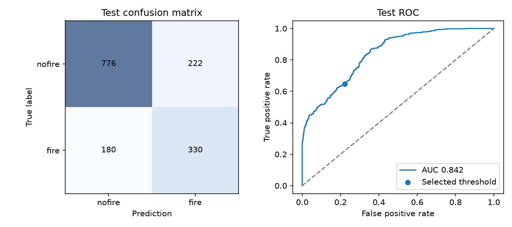

# Wildfire Image Classification

**ECE 491 · Intro to Neural Network · Spring 2023**

A binary image classifier for **fire** and **no fire**, based on the original project’s MobileNetV2 notebook. This version runs locally and includes the dataset, split manifest, trained checkpoint, and evaluation results.

## Run the project

With Python 3.10 or newer, run these commands from this folder:

```sh
python3 -m venv .venv
source .venv/bin/activate
python -m pip install -r requirements.txt
python train.py
```

Training downloads the ImageNet MobileNetV2 weights on first use. It freezes the feature extractor and trains a two-class linear head using AdamW and cross-entropy on raw logits. The training and validation curves cover 20 epochs. The checkpoint is selected by validation loss. The fire cutoff is computed from validation fire scores before scoring the test split.

To classify one or more images with the included checkpoint and its saved fire cutoff:

```sh
python predict.py /path/to/image.jpg
```

Run `python calibrate.py` to recompute the cutoff and plots from an existing checkpoint and split manifest.

## Dataset and evaluation

The `data/fire/` and `data/nofire/` folders contain 9,953 labeled JPEGs from the original project. The recorded experiment retained 9,658 distinct images after duplicate removal. The training script recognizes recording groups from filename prefixes and keeps each group in a single split across both labels. It removes exact decoded-pixel duplicates, including exact horizontal mirrors. If identical content occurs under different prefixes, it keeps those prefixes together. Images with conflicting labels are discarded. Images whose filenames do not identify a recording are kept in training.

| Split | No fire | Fire | Total |
| --- | ---: | ---: | ---: |
| Training | 4,494 | 2,245 | 6,739 |
| Validation | 937 | 474 | 1,411 |
| Test | 998 | 510 | 1,508 |

[Split manifest](results/split.csv) records the files, class labels, source groups, and image fingerprints. The source groups are inferred from filenames. The dataset does not contain verified recording IDs for every image. Changing the names would not recover that information. If a complete source manifest becomes available, supply it with `python train.py --recordings recordings.csv`. Use columns `path,recording_id` and one row per JPEG, with paths relative to `data/`. Images from a single recording should share one ID across both classes. The program checks that the manifest covers every image and keeps each recording together.

Test accuracy, precision, recall, and F1 are calculated from one confusion matrix covering the full test split. ROC AUC uses fire scores from all test images. See [metrics.json](results/metrics.json) for the full results, [learning curves](results/learning-curves.png) for training and validation, and [test evaluation](results/test-evaluation.png) for the confusion matrix and ROC curve.

## Fire detection results

The epoch-8 checkpoint was evaluated on 1,508 images across eight inferred source groups. The cutoff of **0.0471** is the highest practical cutoff that flags at least **99%** of validation fire images, capped at 0.5. The model weights stayed the same.

| Metric | Original cutoff (0.5) | Recall-focused cutoff |
| --- | ---: | ---: |
| Accuracy | 78.45% | 73.34% |
| Fire precision | 90.04% | 59.78% |
| Fire recall | 40.78% | 64.71% |
| Fire F1 | 56.14% | 62.15% |
| Missed fire images | 302 | 180 |
| False fire alerts | 23 | 222 |

The more sensitive cutoff detects **330 of 510** fire images. ROC AUC stays at **0.842** because the model scores and their ranking stay the same. The 99% validation target was chosen during a follow-up analysis of the existing benchmark. This comparison reuses that test set, so it does not establish recall on a fresh dataset.


